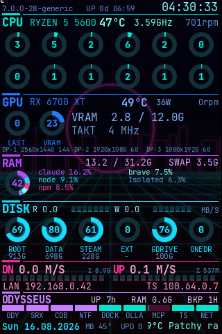

# AX206 Neon Dashboard

A live system dashboard on a 3.5" USB photo frame — the kind of cheap AX206
picture frame that normally cycles through holiday snaps. It shows one ring per
CPU thread, GPU and VRAM load, the five largest memory consumers as a coloured
pie ring, disk fill and throughput, network rates, and a lamp per service.



Driven by [lcd4linux](https://lcd4linux.bulix.org/), which talks to the frame
over USB. The panel is physically 480×320 and mounted portrait via
`Orientation 3`, so the layout works in **320 wide × 480 high**.

## Why this is not just a config file

lcd4linux is a config-driven tool, and for most panels a hand-written config is
the whole job. Three of its properties made that impossible here:

**It has no per-core CPU metric.** There is a `cpu` plugin for the aggregate,
and that is it. Twelve rings need twelve deltas over `/proc/stat`, computed
somewhere else.

**Every `exec()` in the config keeps a worker process alive** — permanently, not
per call. Twelve cores plus service checks plus GPU values would have meant a
dozen resident processes for a picture frame. The finished config contains **no
`exec()` at all**; a single collector service writes every value into one file
in tmpfs, and lcd4linux reads lines from it.

**It cannot draw circles.** Bars are horizontal or vertical, full stop. The
rings are pre-rendered PNGs — one file per percent value, per category colour —
selected at runtime through the filename:

```
file '/run/lcd4linux/gauge/cpu/'.precision(<value>, 0).'.png'
```

So nothing is drawn at runtime; the set is generated once when the collector
starts, because `/run` is tmpfs and empty after every boot.

## Architecture

```
collector.py  ──writes──>  /run/lcd4linux/metrics  ──reads──>  lcd4linux
 (systemd, 2s)               (tmpfs, 64 lines)                 (the panel)
      ▲                                                             ▲
      │ line contract (METRICS)                                     │
      │                                                             │
 build_theme.py  ─────────generates────────>  /etc/lcd4linux/lcd4linux.conf
```

| File | Role |
|---|---|
| `ax206-dash-collect.py` | systemd service, writes every value lcd4linux cannot cheaply produce itself: per-core load, service checks, GPU values behind glob paths, top memory consumers, screens, disk and network throughput, container stats, weather, backup age, pending updates. Expensive lookups get their own intervals; writes are atomic so the panel never reads half a file |
| `build_theme.py` | Generates the lcd4linux config. The layout is pixel arithmetic, so the generator runs a row cursor and **checks its own output** for overflow, overlapping widgets and text fields too narrow for their content |
| `render_gauges.py` | Pre-renders the ring gauges, 4× supersampled, with a blurred glow layer behind each ring |
| `preview.sh` + `vncshot.py` | Renders the theme through lcd4linux's VNC driver into a PNG — the whole layout can be checked **without touching the device** |
| `set_wallpaper.py` | Crops any image to 320×480, dims it, adds scanlines |

The line position in `METRICS` *is* the line number `build_theme.py` reads. Both
sides build that contract from the same source, which is why they always have to
be installed together.

## Configuration

Everything machine-specific lives in `config.toml` — interface, disks, sensors,
location, container, lamps. Collector and generator read the same file, so a
value exists exactly once. Copy `config.example.toml`, which documents every
field, and adjust:

```sh
cp config.example.toml config.toml
sudo ./install.sh
```

Search order is `$AX206_CONFIG`, then `config.toml` next to the scripts, then
`/etc/lcd4linux/ax206-dashboard.toml`. A wrong value never breaks the render —
the affected slot shows `-` or 0.

What is deliberately *not* configurable: the 320×480 geometry, the section
order and the palette. Those live in `build_theme.py`, and a layout engine that
adapts to arbitrary screen sizes would be wasted effort on a device that has
exactly one.

## Design notes

**Rings where something fills up, bars where nothing does.** Anything with a
natural ceiling — cores, GPU, VRAM, RAM, swap, disk fill — is a ring. Bars stay
where a ring would invent a maximum that does not exist: network throughput
(percent of *what*?) and the service lamps (on/off, nothing to fill).

**The RAM ring is a pie ring.** Each of the five largest consumers gets a
segment, everything else occupied gets a dimmed remainder, and the centre shows
total usage. Segment and list entry share a colour, otherwise neither can be
matched to the other. Processes are summed **by name**, because browsers and
Node run as dozens of processes and would otherwise fill the list on their own.

This one cannot be pre-rendered: its appearance depends on five values at once,
which as a PNG set would be five-dimensional. It is drawn at runtime by the
collector (~38 ms every 4 s) into a *fixed* file that the image widget reloads.

**Segmented bars.** `graphicbar` cannot segment, so each segment gets the same
expression and its own value window through `min`/`max` — segment *i* covers
`[i/n, (i+1)/n]` and is therefore empty, partial or full.

**Neon, not flat.** Rings get a blurred copy of themselves composited behind
them; dividers are HUD marks (solid block plus thin line) rather than table
rules; the wallpaper carries scanlines. The scanlines cost brightness exactly
where text would otherwise sit on a bright patch — the effect makes values
*more* legible, not less.

**Colour by category.** Label, value and ring of a section always share a
colour: CPU teal, GPU blue, RAM violet, disks ice blue, network magenta,
container section light violet, secondary info dimmed blue. No green, grey,
white, orange or red. The three blues sit close together but separate cleanly
across sections.

## Installation

```sh
cp config.example.toml config.toml   # then edit
sudo ./install.sh                    # or: sudo IFACE=eth0 ./install.sh
```

Backs up the existing `/etc/lcd4linux/lcd4linux.conf` as `.bak-<timestamp>`.

```sh
./preview.sh /abs/path/preview.png   # check the layout, device untouched
AX206_DEMO=1 ./preview.sh out.png    # same, with placeholder IP addresses
sudo ax206-wallpaper photo.jpg --dim 0.4
```

`preview.sh` chdirs to `/usr/share/lcd4linux` because font paths are relative,
so **give it an absolute output path**.

## Debugging

```sh
systemctl status ax206-dash-collect lcd4linux-ax206
cat /run/lcd4linux/metrics.debug        # line number, name and value per metric
journalctl -u lcd4linux-ax206 -f
```

Empty fields on the panel almost always mean the collector is not running.

## Traps

Every one of these cost time to find, and none of them is documented anywhere.

- **Layout coordinates are `X<row>.Y<column>`** — the *first* number runs down
  (0..479), the second right (0..319). The letters suggest the opposite. Measured
  on the device.
- **Layer 0 is in front**, higher layers behind. The wallpaper belongs on the
  highest layer, not on layer 0.
- **Truetype draws transparently, images and `graphicbar` are opaque.** Text
  therefore sits cleanly on the wallpaper; images need an alpha channel, which
  lcd4linux does honour. This is why the gauges are RGBA and carry their
  percentage *inside* the image — a text widget on top would paint its own
  background over the ring.
- **Font paths are relative to `/usr/share/lcd4linux`.** Started by hand from
  anywhere else, lcd4linux renders silently **without any text at all**.
- **Character width is ~`0.8 × size`**, not the 0.6 you would expect from a
  monospace face. Fields that are too narrow silently cut the last character;
  the generator checks this via a `sample` string per field.
- **Every widget on `update 0`** makes lcd4linux exit with "Not even a single
  timer to process".
- **lcd4linux has no `\u` escapes.** Characters like `Σ` or `°` go into the
  config directly as UTF-8, otherwise you get "unknown escape sequence".
- **`hwmon` numbers shuffle on boot.** Sensors are resolved by driver name
  (`k10temp`, `amdgpu`, …), never as `hwmon2`.
- **`/run` is tmpfs** — the ring PNGs are gone after every boot. The collector
  regenerates them at start. A missing file only produces a warning
  (`fopen … failed`) and an empty spot; it does not crash.
- **FUSE mounts are locked for root** when mounted without `allow_other` — and
  silently so: `statvfs()` returns no error but `f_blocks = 0`. The collector
  runs as root while rclone mounts as the user, so such paths are queried via
  `runuser -u <owner> -- df`. The detour therefore hangs off the condition "no
  size", not off the exception branch.
- **An empty directory is not a mount.** If `~/OneDrive` merely existed without
  anything mounted, `statvfs` would report the root filesystem's numbers and
  thus a fill level that does not exist. `/proc/mounts` is checked first — it
  stays readable even when the mount itself is locked.
- **`docker stats` takes about a second** and would stall the collection loop
  every time. A container's memory is also in its cgroup (`memory.current`); the
  container ID is resolved once a minute, the value then read from a file.
- **`comm` holds 15 characters** and sometimes carries an argument
  (`claude bg-spare`); some programs put their version number there (`2.1.233`).
  The collector cuts at the first space and derives a name from the executable
  path when what is left has no letters.
- **The session is Wayland**, so `xrandr` runs through XWayland, whose cookie is
  `/run/user/<uid>/.mutter-Xwaylandauth.<random>` — the suffix changes on every
  login and must not be hard-coded. As root alone you only get "Authorization
  required".
- **Read resolution from the geometry, not the mode list.** On a rotated screen
  the mode list reports the panel resolution (1920×1080) while what you see is
  the rotated one (1080×1920).
- **`systemctl enable --now` does not restart an already running service.** After
  collector changes a `restart` is required, or the old code keeps running.
- **lcd4linux occasionally segfaults on `restart`** while the USB display is torn
  down. `Restart=on-failure` catches it; it does not happen in steady operation.

## Requirements

Linux with lcd4linux built for the AX206 DPF (`Driver 'DPF'`), Python 3.11+ for
`tomllib`, Pillow for the gauge rendering, and a systemd user- or system-level
service manager. Optional: `docker` for the container section, `rclone` for
cloud mounts, `xrandr` for the screen list.

## Licence

MIT — see `LICENSE`.
